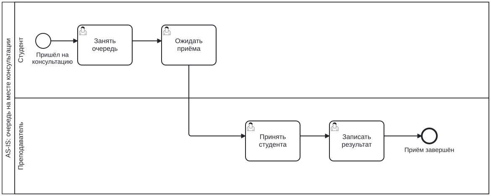
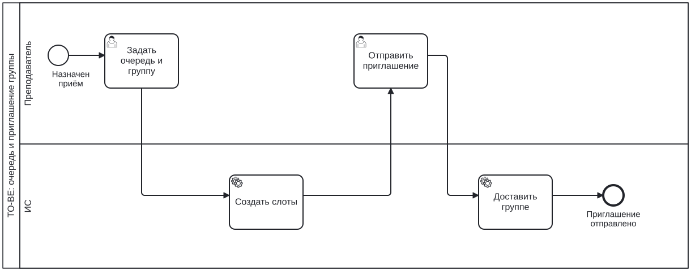
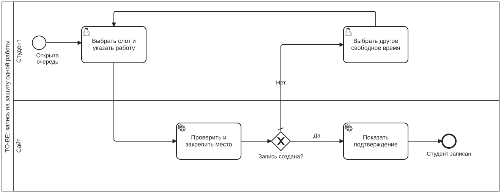
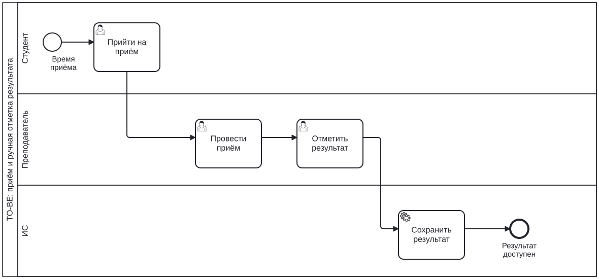

# Концепция информационной системы записи на консультации к преподавателям

**Практическая работа по дисциплине «Проектирование информационных систем»**  
Тема: разработка концепции информационной системы  
Вариант 2 - запись на консультации к преподавателям

Выполнили: Логданиди Кирилл, Газабагандов Шейхахмед  
Группа: K3341
Преподаватель: Духанов Алексей Валентинович 

### Состав команды и распределение ролей

| Проектная роль | Ответственность | Исполнитель |
|---|---|---|
| Руководитель проекта | План работ, ресурсы, итоговые решения | Логданиди Кирилл |
| Аналитик | Описание процесса, проблемы и требования | Логданиди Кирилл |
| Архитектор | Сравнение способов реализации и границы решения | Газабагандов Шейхахмед |
| Аналитик экономики | Расходы и ожидаемые эффекты | Газабагандов Шейхахмед |
| Ответственный за качество | Риски, доступ и показатели приёмки | Газабагандов Шейхахмед |

**Назначение системы:** организовать запись студентов на защиту лабораторных работ во время консультационного приёма преподавателей.

**Основное правило:** один студент и одна работа на один слот длительностью 10 минут. Для разных работ можно занимать несколько слотов.

**Пользователи:** студенты и преподаватели университета. Разработку и сопровождение выполняет ИТ-отдел.

**Результат работы:** сравнение способов организации записи и концепция отдельного сайта на серверах университета.

## 1 Характеристика объекта автоматизации и требования

### 1.1 Объект автоматизации

Запись студентов на защиту лабораторных. Преподаватель назначает очный или онлайн-приём для групп или потока. Обычные консультации без защиты не входят в первую версию.

Учебное условие: университет предоставляет серверы, почту, учётные записи и состав групп. Число преподавателей, групп и консультаций не ограничивается заданными квотами.

### 1.2 Текущий процесс AS-IS

AS-IS — процесс до изменений. Преподаватель публикует общую Google Таблицу в чате. Студенты вписывают себя, время и работу. Преподаватель проверяет список и принимает защиты.

*Рисунок 1. Запись через общую таблицу.*

### 1.3 Проблемы

Проблемы относятся к общему доступу студентов на редактирование таблицы:

| Код | Проблема | Последствие |
|---|---|---|
| P1 | Можно изменить или удалить чужую запись | Споры и недостоверный список |
| P2 | Можно самостоятельно добавить время | Несогласованное расписание приёма |
| P3 | Нет адресного уведомления об открытии записи | Нужно постоянно проверять чаты |
| P4 | Правила записи контролируются вручную | Повторы и ошибки при одновременном редактировании |
| P5 | Результаты и история посещений не связаны надёжно | Сложнее учитывать повторные защиты |

### 1.4 Функциональные требования

Все F1–F12 обязательны (Must) для будущей версии:

| Код | Требование | Проблемы |
|---|---|---|
| F1 | Университетский вход; ФИО и группа подставляются из профиля | P1, P4 |
| F2 | Преподаватель задаёт предмет текстом, группы/поток, дату, время и формат | P2, P3 |
| F3 | Слот — 10 минут, один студент и одна работа; для разных работ можно занять несколько слотов | P2, P4 |
| F4 | Открытие записи: уведомление всем выбранным группам на сайте и почте | P3 |
| F5 | Запись без одобрения; одно место подтверждается только одному студенту | P1, P4 |
| F6 | Выбранные группы видят список, работы и результаты; студент меняет только свою запись | P1, P5 |
| F7 | Отмена и перенос в любое время; при неудачном переносе прежнее место сохраняется | P1, P4 |
| F8 | Преподаватель ставит «Сдал», «Не сдал», «Не пришёл»; до отметки поле пустое | P5 |
| F9 | Название меняется до результата; после отметки работа и результат остаются в истории | P5 |
| F10 | Отмена приёма закрывает запись и уведомляет все выбранные группы; новый приём — без старых записей | P2, P3 |
| F11 | За час до первого слота — напоминание на сайте и почте со всеми записями студента | P3 |
| F12 | Автообновление очереди; сообщения о занятом месте и потере связи | P1, P4 |

Студент вводит только номер или название лабораторной свободным текстом. Доступ определяется университетской группой: пересланная ссылка не даёт права записи. Уведомления одному получателю не дублируются при пересечении групп.

### 1.5 Качество и ограничения

Требования к качеству будущей системы:

| Код | Нефункциональное требование |
|---|---|
| N1 | Студент не меняет чужие записи и результаты; преподаватель управляет своими консультациями |
| N2 | Повторное нажатие не создаёт дубль; при отказе переноса прежняя запись не теряется |
| N3 | Для 95% обычных действий — до 2 секунд; для массового нажатия — до 5 секунд в контрольном испытании |
| N4 | Основные действия доступны в браузере компьютера и телефона |
| N5 | Копии ежедневно; восстановление до 4 часов, потеря данных до 24 часов |
| N6 | История посещений и изменений результатов сохраняется; ресурсы установки можно расширять |

Условия проекта:

| Условие | Принятое решение |
|---|---|
| Размещение | Серверы и почта университета без дополнительных платежей |
| Исполнение | Рабочее время сотрудника ИТ-отдела; свободные программные компоненты |
| Срок | Подготовка и начало пилота не позднее трёх месяцев |
| Пилот | 1–3 предмета, затем решение о расширении |
| Срок работы | Не ограничен одной дисциплиной или семестром |

Подписок и выручки нет. Затраты отражают рабочее время ИТ-сотрудника, а не отдельную доплату.

### 1.6 Границы автоматизации

Сайт ведёт запись, уведомления и результаты. Защиту принимает и результат ставит преподаватель; таймер отметки не выставляет.

Пересечения расписаний не проверяются. При задержке защиты или отмене записи остальные слоты не сдвигаются. Электронный журнал и собственная видеосвязь вне проекта; подключение расписания — дальнейшее развитие.

## 2 Аналитический обзор аналогов и готовых решений

Сравнение по официальным материалам [3–8]:

| Признак | Easy!Appointments | Nextcloud Calendar | Яндекс Формы |
|---|---|---|---|
| Основная задача | Запись к исполнителю | Календарь и запись на встречи | Сбор ответов и заявок |
| Запись по времени | Предусмотрена | Предусмотрена | Ввод в форме; полноценное бронирование требуется организовать отдельно |
| Университетские группы | Требуется адаптация | Требуется настройка/адаптация | Нет готовой учебной модели в личной форме |
| Работа и её результат | Учебный учёт нужно добавить | Учебный учёт нужно добавить | Можно собрать поле; результат вести отдельно |
| Уведомления | О событиях записи | Календарные приглашения и сообщения | Действия по заполнению формы |
| Интеграция | API и средства обмена | Календарные интерфейсы Nextcloud | Интеграции и API сервиса |
| Размещение | Собственный сервер | Собственный сервер Nextcloud | Облако поставщика |
| Лицензирование и стоимость | GPL-3.0; 0 руб. за лицензию свободной установки | AGPL-3.0; 0 руб. за лицензию приложения | Условия облачного сервиса; в смету проекта не включается |
| Главный пробел | Нужны профиль вуза, группы и результаты защит | Стандартный сценарий запрашивает имя и почту с подтверждением | Нет подтверждённого механизма занятия единственного места |

Готовые средства требуют адаптации под университетский вход, группы, лабораторные и результаты. Яндекс Формы — частичный аналог сбора заявок, а не готовая система бронирования.

## 3 Альтернативные варианты концепции ИС

### 3.1 A. Таблица и регламент

Без новой ИС: преподаватель готовит в таблице интервалы по 10 минут и правила, студенты вписывают работу. Плюс — быстрая подготовка. Минус — ручной контроль; персональные права и автоматические уведомления полностью не обеспечены.

### 3.2 B. Раздел университетского портала

В личный кабинет добавляются слоты, группы, уведомления и результаты. Плюс — готовая университетская среда. Минус — зависимость от устройства и обновлений портала. Возможность доработки принята как учебное условие и требует проверки.

### 3.3 C. Отдельный университетский сайт

Веб-приложение с базой записей, университетским входом и почтой. Основа — свободные веб-компоненты и реляционная база данных. Плюс — интерфейс под запись и отдельные обновления. Минус — собственная разработка и поддержка.

### 3.4 Ресурсы вариантов

| Показатель | A | B | C |
|---|---:|---:|---:|
| Первоначальные работы, ч | 16 | 200 | 240 |
| Запуск с резервом, руб. | 8 800 | 110 000 | 132 000 |
| Поддержка, ч/год | 8 | 48 | 36 |
| До начала использования, недели | 2 | 12 | 12 |

Работы выполняет ИТ-сотрудник. Оценки предварительные; состав работ и расчёты — в разделе 6.

## 4 Сравнение вариантов и обоснование выбора

### 4.1 Проверка обязательных требований

| Группа требований | A | B | C |
|---|---|---|---|
| F1: университетский профиль | Нет готового механизма | Подключение к данным портала | Подключение университетского входа |
| F2–F3: предмет, группы, 10 минут, несколько работ | По шаблону и правилам | Разработка раздела | Разработка сайта |
| F4, F10–F11: адресные уведомления и напоминание | Нет автоматического полного сценария | Разработка | Разработка |
| F5, F12, N2: надёжная запись и актуальный список | Общего редактирования недостаточно | Реализация и испытания | Реализация и испытания |
| F6–F9: права, перенос, результаты и история | Частично, ручной контроль | Реализация внутри портала | Реализация внутри сайта |
| N3–N5: скорость, браузер, копии | Зависит от имеющихся средств | Настройка и испытания | Настройка и испытания |
| Существующие серверы и почта | Используются | Используются | Используются |

A исключён: не выполняет все обязательные требования. B и C допустимы при разработке и проверке указанных функций.

### 4.2 Принцип оценки

Вес показывает важность критерия; сумма весов — 1. Оценки: **5 — лучше, 1 — хуже**. Меньшие затраты и более быстрый запуск получают больший балл.

B и C предусматривают одинаковые функции. Удобство и сопровождение оценены предварительно, без испытаний.

### 4.3 Взвешенные оценки и устойчивость

Исходные данные: TCO — создание и поддержка за три года; сроки и затраты — учебные оценки.

| Показатель | A: таблица | B: портал | C: сайт |
|---|---:|---:|---:|
| До начала использования, недель | 2 | 12 | 12 |
| Создание и поддержка за 3 года (TCO), руб. | 20 800 | 182 000 | 186 000 |

**Ниже баллы, а не недели или рубли. A указан справочно.**

| Критерий | Вес | A, справочно | B | C |
|---|---:|---:|---:|---:|
| K1. Соответствие функциям | 0,30 | 2 | 5 | 5 |
| K2. Удобство | 0,25 | 2 | 4 | 5 |
| K3. Простота сопровождения | 0,20 | 3 | 3 | 4 |
| K4. Стоимость владения за 3 года (дешевле — выше балл) | 0,15 | 5 | 4 | 4 |
| K5. Скорость запуска (быстрее — выше балл) | 0,10 | 5 | 3 | 3 |
| **Итог** | **1,00** | **2,95** | **4,00** | **4,45** |

Основания оценок:

- K1: B/C предусматривают все функции; у A есть обязательные пробелы.
- K2: предполагается меньше переходов в C, чем в B; у A — ручная сверка списка.
- K3: предполагаются отдельные обновления C; B зависит от портала, A — от ручного ведения правил.
- K4: баллы 5/4/3/2/1 для TCO до 50 / 200 / 300 / 500 / свыше 500 тыс. руб. соответственно. B/C входят в один диапазон.
- K5: баллы 5/4/3/2/1 для запуска до 4 / 10 / 12 / 16 / свыше 16 недель соответственно. A запускается за 2 недели и получает 5; B и C — за 12 недель и получают по 3.

**Итог = сумма произведений весов на баллы.** Для C: 0,30×5 + 0,25×5 + 0,20×4 + 0,15×4 + 0,10×3 = **4,45**.

Проверка веса K1: ±0,05; остальные веса изменены пропорционально с сохранением суммы 1.

| Вес K1 | B | C | Лидер |
|---|---:|---:|---|
| 0,25 | 3,929 | 4,411 | C |
| 0,30 | 4,000 | 4,450 | C |
| 0,35 | 4,071 | 4,489 | C |

C сохраняет лидерство при изменении веса K1. Отдельно проверено, что будет при равных с B оценках удобства и сопровождения:

| Сценарий | B | C | Лидер |
|---|---:|---:|---|
| Исходные оценки | 4,00 | 4,45 | C |
| Удобство C равно B: K2 = 4 | 4,00 | 4,20 | C |
| Сопровождение C равно B: K3 = 3 | 4,00 | 4,25 | C |
| Оба преимущества C не подтвердились: K2 = 4, K3 = 3 | 4,00 | 4,00 | B и C |

**Выбран C для дальнейшей проработки.** Его преимущества по удобству и сопровождению нужно подтвердить макетами и обследованием портала. Если оба преимущества не подтвердятся, B и C получат по 4,00; выбор потребует дополнительного сравнения.

## 5 Описание выбранной концепции и TO-BE

### 5.1 Состав решения

Сайт размещается на серверах университета. Студент и преподаватель входят под университетской учётной записью. Сайт получает подтверждённые ФИО, роль и сведения о группах; отдельная регистрация с произвольным указанием группы не требуется.

Укрупнённая архитектура: **браузер → сайт → база записей и результатов**. Университетские системы предоставляют вход, состав групп и почту. Способ подключения уточняет ИТ-отдел. Наличие отдельного сайта не исключает эти зависимости.

### 5.2 Открытие записи

*Рисунок 2. Преподаватель открывает приём, сайт уведомляет выбранную аудиторию.*

Преподаватель вводит предмет, выбирает группы или поток, дату и интервал, указывает аудиторию либо ссылку на онлайн-защиту. При нажатии «Открыть запись» создаются десятиминутные слоты и уведомления на сайте и университетской почте.

Пример: **14:00–16:00 — 12 слотов по 10 минут**. Очередь общая по предмету: студент сам указывает, какую лабораторную будет защищать. Преподавателю не нужно создавать список всех работ заранее.

| Событие | Получатели |
|---|---|
| Открытие записи | Все студенты выбранных групп или потока |
| Отмена консультации | Вся та же аудитория, включая незаписавшихся |
| Напоминание за час до первого слота | Записанный студент; сообщение содержит все его слоты в этой консультации |

Сохранение черновика не запускает рассылку. Очередь можно открыть непосредственно на сайте: получение письма не является обязательным условием записи.

### 5.3 Самостоятельная запись

*Рисунок 3. Занятие свободного места и повторный выбор при отказе.*

После входа студент открывает доступную очередь, выбирает время и заполняет одно поле — номер или название лабораторной. После подтверждения сервером появляется «Вы записаны». Для другой работы можно занять ещё один свободный слот.

Если несколько студентов почти одновременно выбрали одно место, подтверждается только одна запись. Остальные видят, что слот занят, и выбирают другое время. Уже введённая лабораторная сохраняется. Список обновляется автоматически; повторное нажатие не создаёт дубль.

Студенты своей аудитории видят ФИО других записанных, их работы и результаты. При этом чужие записи и отметки изменить нельзя.

### 5.4 Отмена, перенос и связь

| Ситуация | Поведение сайта |
|---|---|
| Студент отменил свою запись | Освобождается только это место; время остальных сохраняется |
| Студент выбирает другое время | При успешном переносе закрепляется новое место и освобождается прежнее |
| Новое место успели занять | Перенос отклоняется, прежняя запись остаётся |
| Связь прервалась | Сайт предупреждает об устаревших данных и проверяет результат после восстановления |
| Преподаватель отменил приём | Новые записи закрываются, вся аудитория получает уведомление, история сохраняется |
| Преподаватель меняет дату или время | Открывает новую консультацию с пустым списком; студенты записываются заново |

Срок «за сутки», «за час» или «до начала своего слота» для изменения собственной записи не устанавливается. Это не даёт возможности стереть уже отмеченное посещение. Новая запись после результата хранится отдельно и появляется без отметки.

Предмет и лабораторная задаются текстом. Сайт хранит заявленное название, а фактическое содержание защиты проверяет преподаватель.

### 5.5 Защита, неявка и история

*Рисунок 4. Преподаватель проверяет явку и вручную фиксирует результат.*

| Время | Студент | Работа | Результат |
|---|---|---|---|
| 14:00–14:10 | Студент 1 | Лабораторная № 1 | Сдал |
| 14:10–14:20 | Студент 1 | Лабораторная № 3 | Не сдал |
| 14:20–14:30 | Студент 2 | Лабораторная № 2 | Не пришёл |
| 14:30–14:40 | Студент 3 | Лабораторная № 4 | Не отмечен |

«Не отмечен» означает пустой результат до решения преподавателя. Таймер не выставляет ни одну из трёх отметок. Если студент отсутствует, «Не пришёл» выбирает преподаватель.

Лабораторную можно переименовать до результата. После отметки название и результат сохраняются вместе в истории. Для другой работы или повторной защиты создаётся новое посещение с пустым результатом; предыдущая неявка или несданная работа не исчезает.

Если защита затянулась, слоты автоматически не сдвигаются. Преподаватель регулирует фактический приём. Запись уменьшает организационную неопределённость, но сама по себе не гарантирует отсутствие задержек.

### 5.6 Изменения процесса

Время назначает преподаватель, а личность студента подтверждает университетская учётная запись. Общая редактируемая таблица заменяется действиями с проверкой прав. Уведомление сообщает об открытии очереди без постоянной проверки чата. Работа, время и результат связаны в одном посещении.

ИТ-отдел обеспечивает размещение, подключение входа и почты, копии и сопровождение. Он не распределяет места и не принимает решения о сдаче лабораторных.

## 6 Ожидаемые эффекты и затраты

### 6.1 Основания расчёта

Серверы и почту предоставляет университет. В модели нет новых платежей за их аренду и пользовательских подписок. Учитывается стоимость занятости ИТ-сотрудника на создание и поддержку.

Для учебной сметы принят месячный ориентир **80 000 руб.** и расчётные **160 ч**: 80 000 / 160 = **500 руб. за час ИТ-работы**. Внешний ориентир — публикация Центра карьеры ИТМО с предложением веб-разработчику от 80 тыс. руб./месяц [9]. Это не сведения о зарплате конкретного сотрудника. Норма 160 ч и применение ориентира ко всем этапам являются допущениями; полный фонд оплаты труда с начислениями не рассчитывается.

Часы ниже — предварительная оценка объёма работ. Они уточняются после обследования портала, университетского входа и макетов. Стоимость часа преподавателя или практиканта не вводится.

### 6.2 Смета выбранного варианта C

| Работа | Часы | Оценка, руб. |
|---|---:|---:|
| Сценарии и макеты | 24 | 12 000 |
| Сайт и университетский вход | 48 | 24 000 |
| Запись, перенос, история и результаты | 80 | 40 000 |
| Уведомления и напоминания | 24 | 12 000 |
| Испытания и исправления | 48 | 24 000 |
| Размещение, инструкции и запуск | 16 | 8 000 |
| **Работы** | **240** | **120 000** |
| Резерв 10% | — | 12 000 |
| **Запуск с резервом** | | **132 000** |

Поддержка C оценена в **36 ч/год**, или **18 000 руб./год**: обновления, проверка копий и помощь пользователям примерно по 12 ч на каждое направление. Крупные новые функции оцениваются отдельно.

Эти суммы отражают стоимость трудового ресурса, а не обязательные дополнительные выплаты. Достаточность предоставленных серверов необходимо проверить нагрузочными испытаниями.

### 6.3 Стоимость владения и эффект в часах

TCO = затраты на запуск + 3 × ежегодная поддержка. Для C: **132 000 + 3 × 18 000 = 186 000 руб.**

| Показатель | A, справочно | B | C |
|---|---:|---:|---:|
| Запуск с резервом, руб. | 8 800 | 110 000 | 132 000 |
| Поддержка, руб./год | 4 000 | 24 000 | 18 000 |
| **TCO за три года, руб.** | **20 800** | **182 000** | **186 000** |

B первоначально дешевле, но в расчёте требует 48 ч поддержки в год из-за связи с обновлениями портала. Это плановая гипотеза, а не результат изучения конкретного кода. TCO B и C близки; основное различие выбора относится к удобству и сопровождению.

**Пример нагрузки:** 3 предмета × 20 защит в неделю × 32 учебные недели = **1 920 защит в год**. За четыре недели при той же нагрузке — 240 защит. Три предмета взяты для расчёта; пилот может включать 1–3 предмета, а система не ограничивается ими.

Для организационных действий приняты 1,5 мин на запись до внедрения, 1 мин для A и 0,5 мин для B/C. Включаются проверка списка, уточнения и фиксация сведений; сама десятиминутная защита исключается. Значения являются гипотезами для хронометража.

| Вариант | После, мин/запись | Экономия, ч/год | За четыре недели при 3 предметах, ч |
|---|---:|---:|---:|
| A | 1,0 | 16 | 2 |
| B | 0,5 | 32 | 4 |
| C | 0,5 | 32 | 4 |

Для C: **1 920 × (1,5 − 0,5) / 60 = 32 ч/год**. При 960 защитах получается 16 ч, при 2 880 — 48 ч. Это расчёт для выбранной нагрузки, а не уже достигнутый эффект и не прогноз на весь университет.

**Денежный эффект не оценивается. ROI и срок окупаемости в принятой модели не определяются.** Целесообразность обосновывается трудозатратами и улучшением организации приёма. Отсутствие денежной оценки не подменяется нулём. В этой части используется упрощение относительно требования методички о численном расчёте ROI и окупаемости.

### 6.4 Неденежные эффекты и измерение пользы

| Показатель | Цель пилота | Как проверяется |
|---|---|---|
| Организационное время на запись | Сокращение не менее чем на 30% | Хронометраж сопоставимых действий до и после, не менее 30 наблюдений |
| Ошибочные изменения чужих записей | 0 успешных изменений в контрольных проверках | Действия под разными учётными записями |
| Адресаты открытия и отмены | Полное совпадение с выбранной аудиторией | Сопоставление списков получателей и групп |
| Самостоятельная запись | Не менее 95% без помощи преподавателя | Учёт обращений за помощью и созданных записей |
| Удобство для студентов | Не менее 80% оценок 4–5 из 5 | Короткий опрос не менее 20 участников |

Самостоятельная запись существовала и в общей таблице. Её улучшение оценивается по понятности действий, правам и необходимости помощи, а не по утверждению, что раньше она отсутствовала.

Время ожидания и споры также фиксируются на пилоте, но неподтверждённое исходное ожидание в 30 минут не используется. Для сравнения выбираются одинаковые по типу защиты и сопоставимая нагрузка. Задержка самой защиты не считается ошибкой бронирования.

### 6.5 Вывод по целесообразности

Сайт не приносит выручку. Его задача — сделать запись предсказуемой, сократить ручные исправления списка, сообщать об открытии и отмене и сохранять результаты защит.

Расходы необходимо оценивать вместе с этими эффектами. C требует большей первоначальной работы, чем B, но позволяет поддерживать отдельный сервис под узкий процесс. По итогам пилота проверяются трудозатраты, удобство и реальная нагрузка; при недостаточной пользе состав функций и способ реализации пересматриваются.

Подробности: [исходные допущения](calculations/assumptions.json), [таблицы расчётов](calculations/results.md) и [скрипт пересчёта](calculations/calculate.py). Скрипт рассчитывает затраты, баллы и экономию часов; денежную оценку преподавательского времени не выполняет.

## 7 Реестр рисков и меры реагирования

Вероятность P и влияние I оцениваются от 1 до 5; R = P × I. Высокий риск — 15–25, средний — 8–14, низкий — 1–7.

| Код | Риск | P | I | R |
|---|---|---:|---:|---:|
| R1 | Ошибочный состав группы и адресатов | 3 | 5 | 15 |
| R2 | Двойная запись или потеря места при переносе | 3 | 5 | 15 |
| R3 | Изменение чужих сведений или доступ посторонней группы | 3 | 5 | 15 |
| R4 | Недоступны университетский вход или данные профиля | 3 | 4 | 12 |
| R5 | Пик нажатий замедляет сайт | 3 | 4 | 12 |
| R6 | Автоматическое сообщение не доставлено | 3 | 3 | 9 |
| R7 | Защиты затягиваются и возникает ожидание | 4 | 3 | 12 |
| R8 | Трудоёмкость выше оценки, ИТ-сотрудник занят другими задачами | 3 | 3 | 9 |
| R9 | Порядок доступа и обработки сведений не согласован | 2 | 4 | 8 |
| R10 | Сбой обновления или утрата данных | 2 | 4 | 8 |

| Код | Стратегия и профилактика | Реагирование / ответственный |
|---|---|---|
| R1 | Снизить: проверить группы до рассылки | Исправить состав и повторить сверку; ИТ-отдел |
| R2 | Снизить: испытать одновременную запись и перенос | Устранить ошибку, восстановить согласованные записи; ИТ-отдел |
| R3 | Снизить: проверки прав для каждой роли | Закрыть ошибочный доступ, проверить историю; ИТ-отдел |
| R4 | Снизить: заранее проверить подключение и доступность | Сообщить о сбое, восстановить вход; ИТ-отдел |
| R5 | Снизить: испытать штатную и пиковую нагрузку | Исправить узкое место, повторить проверку; ИТ-отдел |
| R6 | Снизить: контролировать отправку, сохранять сообщение на сайте | Повторить доставку, проверить почту; ИТ-отдел |
| R7 | Снизить: реалистичный план приёма | Объяснить задержку и регулировать приём; преподаватель |
| R8 | Снизить: резерв и поэтапная реализация | Уточнить объём и график; руководитель проекта |
| R9 | Избежать: согласовать правила до реальных данных | Отложить загрузку до устранения пробела; представитель вуза |
| R10 | Снизить: копии и пробное восстановление | Восстановить рабочую версию; ИТ-отдел |

Приоритетны R1–R3. Разрешённый просмотр результатов студентами своей аудитории не считается нарушением; риск связан с изменением без прав или доступом вне аудитории. Оценки рисков уточняются после пилота.

## 8 Порядок оценки качества и условия приёмки

### 8.1 Проверяемые показатели

| Код | Условие успешной проверки |
|---|---|
| Q1 | Слот 10 минут, одна работа на запись; одному студенту доступны несколько слотов. Профиль подставляется без повторного ввода ФИО |
| Q2 | При одновременных попытках занять одно место — ровно одна действующая запись. Повторные нажатия и запросы не создают дубль |
| Q3 | Неудачный перенос сохраняет прежнее место; отмеченное посещение и название работы остаются в истории, новое — без результата |
| Q4 | 0 успешных изменений чужих записей; посторонняя группа не записывается. Студенты своей аудитории видят предусмотренные общие сведения |
| Q5 | Открытие/отмена уведомляют всю аудиторию, напоминание — записанного студента. Список обновляется без ручной перезагрузки за несколько секунд при работающей связи |
| Q6 | 95% обычных действий до 2 с, массового нажатия до 5 с. Начальные профили — 50 активных пользователей на пилоте и 500 при расширении |
| Q7 | Ежедневная копия и контрольное восстановление до 4 ч с потерей данных не более 24 ч |

В Q1 и Q3 дополнительно проверяются три ручных результата, отсутствие автоматической отметки по времени, отмена без сдвига чужих слотов и сохранение прежнего «Не пришёл» при новой записи.

В Q5 сопоставляют списки адресатов и события на сайте; почтовую отправку и фактическую доставку проверяют отдельно. При сбое почты запись остаётся доступной. При потере связи сайт не показывает неподтверждённый успех.

Числа 50 и 500 — условия будущих испытаний, а не измеренная мощность сервера и не лимит числа учётных записей. Второй ориентир уточняется по пикам пилота и прогнозу расширения. 95% означает не менее 95 из 100 действий; остальные задержки также фиксируются.

### 8.2 Порядок приёмки

1. Подготовить контрольные группы, профили, консультации и ожидаемые результаты.
2. Проверить обычные сценарии студента и преподавателя в браузере компьютера и телефона.
3. Проверить одновременные нажатия, повтор запроса, перенос, потерю связи и отмену во время записи.
4. Проверить нагрузку и восстановление; устранить ошибки и повторить затронутые сценарии.
5. Провести четырёхнедельный пилот на 1–3 предметах и собрать KPI раздела 6.
6. Рассмотреть протоколы и принять решение о запуске, доработках или расширении.

Участвуют представитель вуза, ИТ-отдел, преподаватели и студенты пилота. Документы: программа и протокол испытаний, перечень замечаний, отчёт пилота и решение о приёмке. При невыполнении обязательного требования запуск откладывается. Проверки ещё не проводились: в концепции описаны ожидаемые условия.

## 9 Выводы и дорожная карта

### 9.1 Выводы

Выбрана концепция отдельного университетского сайта для записи на защиту лабораторных. Один слот длится 10 минут и относится к одной работе; для разных работ студент может занять несколько мест. Личные сведения поступают из университетского профиля.

По сравнению с общей таблицей сайт ограничивает изменение чужих записей, закрепляет время преподавателя, автоматически информирует выбранную аудиторию и связывает результат с посещением. Он сохраняет историю и обрабатывает конкуренцию за одно место без двойной записи.

Из трёх альтернатив A не обеспечивает обязательный сценарий. При исходных оценках C получает 4,45 балла, B — 4,00. C сохраняет лидерство при изменении веса K1 на ±0,05, но при равных оценках удобства и сопровождения B и C получают по 4,00. Выбор сайта условен: его преимущества нужно подтвердить макетами и обследованием портала, иначе решение пересматривается.

Предварительная стоимость запуска C — 132 000 руб. трудового ресурса с резервом, TCO за три года — 186 000 руб. Расчётный пример даёт 32 часа организационного времени в год; результат должен быть проверен на пилоте. Денежная окупаемость не заявляется.

### 9.2 План реализации

| Период | Работа | Ответственный | Результат |
|---|---|---|---|
| Недели 1–2 | Уточнить процесс, доступ к университетским данным и макеты | ИТ-отдел, преподаватели | Согласованные сценарии |
| Недели 3–9 | Реализовать вход, запись, историю, результаты и сообщения | ИТ-отдел | Рабочая версия сайта |
| Недели 10–11 | Проверить Q1–Q7 и исправить ошибки | ИТ-отдел, участники проверки | Протокол без критических замечаний |
| Неделя 12 | Разместить, подготовить инструкции и начать пилот | ИТ-отдел, преподаватели | Пилот на 1–3 предметах |
| Недели 12–15 | Наблюдать четыре недели и оценить KPI | Представители пользователей и вуза | Решение о дальнейшем использовании |

Три месяца относятся к подготовке и началу пилота. Поддержка и дальнейшая работа системы этим сроком не ограничиваются. Наблюдение пилота использует предусмотренный ресурс сопровождения.

На стадию технического задания передаются требования, правила записи и результатов, BPMN-модели, показатели приёмки, допущения и смета. Интеграция с расписанием занятий остаётся направлением развития. Детали экранов и конкретные настройки инфраструктуры уточняются при реализации.

## Список источников

Дата обращения к веб-источникам: **28.10.2026**.

1. Методические указания к практической работе «Разработка концепции информационной системы». Структура концепции, альтернативы, взвешенные оценки, риски и приёмка.

2. «Варианты ИС для разработки концепции». Вариант 2: «Запись на консультации к преподавателям».

3. Easy!Appointments. [Возможности свободной версии](https://easyappointments.org/features/). Запись к исполнителю, расписание и сообщения.

4. Easy!Appointments. [Официальный репозиторий](https://github.com/alextselegidis/easyappointments). Самостоятельное размещение и лицензия GPL-3.0.

5. Nextcloud. [Calendar: запись на встречи](https://docs.nextcloud.com/server/latest/user_manual/en/groupware/calendar.html). Организация слотов, подтверждение почты, отмена и уведомления.

6. Nextcloud. [Репозиторий Calendar](https://github.com/nextcloud/calendar). Назначение приложения и лицензия AGPL-3.0.

7. Яндекс. [Личные формы и формы для бизнеса](https://yandex.ru/support/forms/ru/go-to-forms). Модель облачного сервиса и организация доступа.

8. Яндекс. [Автоматические действия](https://yandex.ru/support/forms/ru/notifications). События заполнения формы и отправка сообщений.

9. Центр карьеры ИТМО. [Подборка вакансий](https://t.me/s/careercentreitmo?before=1341). Ориентир предложения веб-разработчику от 80 тыс. руб./месяц; используется для учебного допущения, а не как подтверждение оплаты сотрудника вуза.

## Приложения

- [Исходные значения и допущения](calculations/assumptions.json).
- [Расчёты затрат, оценок и эффекта в часах](calculations/results.md).
- [Скрипт пересчёта](calculations/calculate.py).
- Редактируемые BPMN: [AS-IS](assets/as-is.bpmn), [открытие записи](assets/publication.bpmn), [бронирование](assets/to-be.bpmn), [защита и результат](assets/assessment.bpmn).
